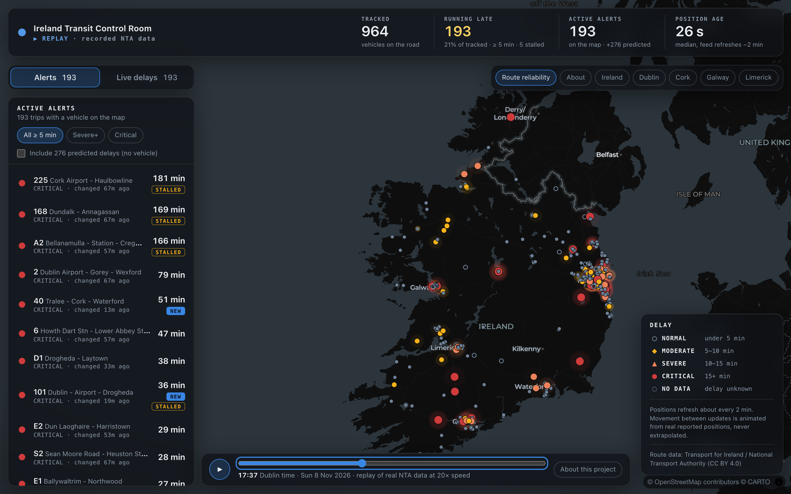
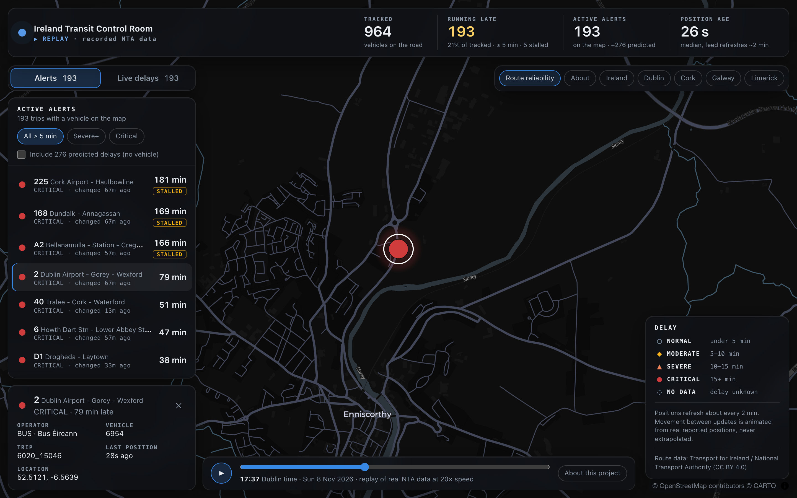
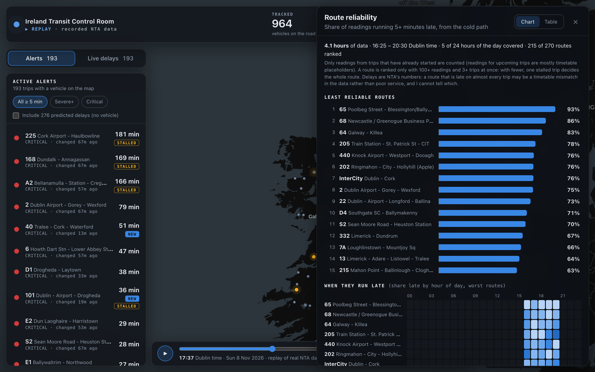
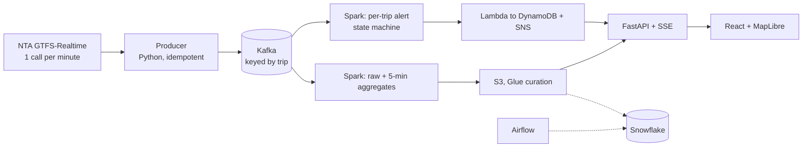

# Real-time delay alerting for Irish public transport

[](https://github.com/Raiyan708/Live_GTFS_Transport_Ireland/actions/workflows/tests.yml)

A streaming data-engineering project on the National Transport Authority's live **GTFS-Realtime** feed: about 1,000 vehicles and 3,000 trips every
two minutes, turned into per-trip delay alerts and route-reliability analytics, with a live map. Kafka, Spark Structured Streaming, a stateful alert
state machine, Lambda/DynamoDB, Glue, Snowflake, Airflow, FastAPI and React.

**Live demo (a replay of real data recorded on 8 Nov 2026):** <https://raiyan708.github.io/Live_GTFS_Transport_Ireland/>
*(works once GitHub Pages is enabled for this repo: Settings, Pages, Source = GitHub Actions)*



<table>
<tr><td width="50%"></td>
<td width="50%"></td></tr>
</table>

## What running it on real data taught me
The simulator told me the design worked. The live feed told me where it did not. Each number below was measured (details and method in
[`docs/DECISION_LOG.md`](docs/DECISION_LOG.md), Phases 8 to 8c).

| Finding | What I changed |
|---|---|
| Spark's route aggregates agree with an independent recomputation from raw Kafka: **0 differences over 4,599 route-windows** | nothing: it is the evidence the numbers can be trusted |
| **40.7%** of readings are for trips that have not started; 89% of those are placeholder zeros. True late share among running trips is **30%, not 19%** | readings from not-yet-started trips are excluded from reliability stats |
| Alerts for trips with **no vehicle flipped in bulk** (up to 45% in one step); vehicle-backed alerts moved **0.4%** per step | the default alert view shows only vehicle-backed alerts; predicted ones are a switch |
| **10 of 18** extreme delays grow exactly 1:1 with the clock (a trip not progressing along its timetable) | a `STALLED` flag instead of a plain "critical" |
| **99.8%** of trips appear in back-to-back snapshots | alert expiry cut from 30 to 10 minutes, chosen from the data |
| Expired alerts stayed active when expiry and start shared a timestamp | fixed in the Lambda, test written first |
| My own dashboard API **snowballed the single-threaded storage emulator** and starved Spark for ~20 minutes | single-flight cache, client timeouts, page cap; 40 concurrent polls now cost 2-3 queries |

## Architecture

Solid arrows ran end to end on the live feed. **Dashed ones (Snowflake, Airflow) are written and unit-tested but have not run against real services**;
the AWS services run on a local emulator and the Terraform has been validated, not applied. See the status table at the bottom.

## Engineering practices worth a look
- **Verified, not assumed:** parity tests between Spark and pure-Python implementations of the same rule; independent recomputation of aggregates; and
  **mutation testing** (break the code on purpose, confirm a test fails). That caught real gaps in the tests themselves.
- **Honest data work:** every limitation is written down next to the number it affects, including what is *not* proven.
- **Delivery semantics:** at-least-once plus idempotent sinks (deterministic alert ids, conditional writes, partition-replace loads), not a claimed "exactly once".
- **259 automated tests** (204 Python, 29 web, 13 Spark in a container, 13 Airflow in a container), CI on every push, a clean-clone install check.

## Run it locally (no AWS or Snowflake account needed)
Needs Docker. Python is only used on the host for the producer, Lambda runner, tests and dashboard.
```bash
python3 -m venv .venv && ./.venv/bin/pip install -r requirements.txt
cp .env.example .env
docker compose up -d kafka kafka-init aws-emulator aws-init          # Kafka + S3/DynamoDB/SNS emulator (moto)
export PYTHONPATH=src AWS_ENDPOINT_URL=http://localhost:5555 AWS_DEFAULT_REGION=eu-west-1 AWS_ACCESS_KEY_ID=test AWS_SECRET_ACCESS_KEY=test
./.venv/bin/python scripts/init_aws_local.py                         # DynamoDB tables + SNS topic
docker compose --profile streaming up -d spark-raw-sink spark-route-aggregates spark-delay-alerts spark-alerts-sink
FEED_MODE=simulator POLL_INTERVAL_SECONDS=2 ./.venv/bin/python -m gtfsrt.producer          # synthetic feed (real protobuf bytes)
ALERT_TOPIC_ARN=arn:aws:sns:eu-west-1:123456789012:gtfsr-alerts ./.venv/bin/python -m gtfsrt.lambda_alerts.local_runner
./scripts/run_curate_local.sh --process_dates $(date -u +%F)         # Glue job, run locally
./scripts/run_dashboard.sh                                           # legacy Streamlit view: http://localhost:8501
```

### The control room (React + FastAPI)
Needs Node 20+ and the producer running (it reads the last ~6 min from Kafka).
```bash
PYTHONPATH=src:. ./.venv/bin/python -m uvicorn dashboard.api:app --port 8000   # API: /api/vehicles, /api/stream (SSE), /api/health
cd web && npm install && npm run dev                                          # http://localhost:5173
```
The map tiles come from a third-party service (CARTO) fetched by *your browser*; set `VITE_MAP_STYLE` to use another style. The Alerts tab needs the hot path running (next block); without it the panel says so and the "Live delays" tab still works.
For the live feed: `FEED_MODE=live` with the variables from `.env.example` (same names as your real `.env`). Live mode makes **one API call per 60 s, alternating the two feeds** (NTA fair-usage limit), so each feed refreshes every 120 s.
`src/gtfsrt/producer.py` **has** now been run against the live API (2026-11-08, ~22 min; see `docs/DECISION_LOG.md` Phase 8). Finding: trip updates carry no per-trip timestamp, so the lag report cannot size the watermark for the alert path; it stays at 2 min.

> ⚠ Stop Spark jobs **by name**: `docker compose --profile streaming stop spark-raw-sink …`. A bare `stop` also stops Kafka and the emulator,
> and the emulator keeps S3 in memory, so the lake is lost (it can be rebuilt by replaying Kafka).
> Tear down: `docker compose --profile streaming down -v`.

### Hot path on the live feed (alerts panel)
Replays whatever is in Kafka, then follows the live feed. Route names: download `GTFS_Realtime.zip` from Transport for Ireland into `data/gtfs_static/`, then
```bash
PYTHONPATH=src ./.venv/bin/python -m gtfsrt.static_gtfs                  # data/gtfs_static/routes.json
docker compose --profile streaming up -d spark-delay-alerts spark-alerts-sink
export PYTHONPATH=src AWS_ENDPOINT_URL=http://localhost:5555 AWS_DEFAULT_REGION=eu-west-1 AWS_ACCESS_KEY_ID=test AWS_SECRET_ACCESS_KEY=test
ALERT_TOPIC_ARN=arn:aws:sns:eu-west-1:123456789012:gtfsr-alerts ./.venv/bin/python -m gtfsrt.lambda_alerts.local_runner
PYTHONPATH=src:. ./.venv/bin/python -m uvicorn dashboard.api:app --port 8000      # needs the exports above to reach DynamoDB
```
`ALERT_EXPIRY_SECONDS` defaults to 600 (see Phase 8b of the decision log for why).

### Cold path on the live feed (reliability view)
```bash
docker compose --profile streaming up -d spark-raw-sink spark-route-aggregates        # replays Kafka, then follows the feed
./scripts/run_curate_local.sh --process_dates $(date -u +%F) --run_id live-1           # Glue: curated -> serving (check the exit code!)
```
Then open **Route reliability** in the control room. Add `S3_ENDPOINT_URL=http://localhost:5555` to the API's environment so it can read the lake.
> Do not run more than a couple of pollers against the emulator: it is single-threaded. The API shares one cached query between all open tabs (Phase 8c, D8.12).

### The public demo (a recording of real data)
A recruiter cannot run Kafka and Spark, so the dashboard has a **demo mode** that replays a recording. The recording is not synthetic: every frame is
produced by replaying the real events from Kafka through the same `VehicleBoard`, alert state machine and API shaping code the live system uses.
```bash
# record (needs the stack running with real data in Kafka and the Glue step done):
AWS_ACCESS_KEY_ID=test AWS_SECRET_ACCESS_KEY=test S3_ENDPOINT_URL=http://localhost:5555 PYTHONPATH=src:. \
  ./.venv/bin/python scripts/build_demo_data.py --from 2026-11-08T17:00:00Z --to 2026-11-08T18:30:00Z
# try it locally:
cd web && npm run dev            # then open http://localhost:5173/?demo=1
```
`.github/workflows/deploy-demo.yml` builds it with `VITE_DEMO=1` and publishes to GitHub Pages. The data is NTA open data (CC BY 4.0); attribution is shown in the app.

### Snowflake, for real, with only a trial account
`docs/SNOWFLAKE_RUNBOOK.md` and `scripts/snowflake_verify.py`: create the objects, load through an internal stage with the production COPY, run the DQ SQL, and compare the
Snowflake views with the pandas twins. **Until you run it, the Snowflake SQL has never executed.** `--dry-run` previews everything without connecting.

## Tests (259)
```bash
./.venv/bin/pytest -q              # 204 — state machine, decoding, Lambda (moto), DQ (SQLite), Snowflake SQL, dashboard views + API, packaging
(cd web && npm test)               # 29 — delay bands, position gliding, route naming, reliability colour scale
./scripts/run_spark_tests.sh       # 11 — Glue transforms, in the Spark container (host has no Java)
./scripts/run_airflow_tests.sh     # 13 — the DAG, in an Airflow 2.10 image
```

## First check on the live feed (free, ~20 min)
Uses only your existing `.env`. Answers what the simulator cannot: real route-id format, real event-time lag (sizes the watermark), rate-limit behaviour.
```bash
docker compose up -d kafka kafka-init aws-emulator aws-init
FEED_MODE=live PYTHONPATH=src ./.venv/bin/python -m gtfsrt.producer     # one API call / 60 s; run 15-20 min, then Ctrl+C
PYTHONPATH=src ./.venv/bin/python -m gtfsrt.lag_report                  # lag percentiles, route-id examples, suggested watermark
```
Use **`src/gtfsrt/producer.py`** for this, not `ingestion/main.py`: the Spark jobs need `event_time` and `current_delay_seconds`, which only the former writes
(your `ingestion/` records carry `trip_update_timestamp` and no delay summary, so the Spark jobs would silently drop every row).

## Layout
| Path | What |
|---|---|
| `src/gtfsrt/` | `decode`, `producer`, `simulator`, **`alerting`** (pure state machine), `streaming/` (Spark jobs), `lambda_alerts/`, `transform/`, `warehouse/` |
| `glue/curate_job.py` | Glue ETL entrypoint (also runs locally) |
| `snowflake/` | setup, storage, tables, views, Snowpipe alternative (**never executed**) |
| `airflow/dags/` | control-plane DAG |
| `infra/terraform/` | `terraform validate` passes; **never applied** |
| `dashboard/` | `api.py` + `vehicles.py` (FastAPI, live vehicle board), `views.py`/`sources.py` (hot: DynamoDB, cold: Snowflake or local Parquet), `app.py` (legacy Streamlit) |
| `web/` | React + TypeScript control room (MapLibre map, Motion animation); `web/public/demo/` is the recorded replay |
| `scripts/build_demo_data.py` | records the demo from real Kafka data using the production code paths |
| `scripts/snowflake_verify.py`, `docs/SNOWFLAKE_RUNBOOK.md` | the real-Snowflake verification (never executed until you run it) |
| `.github/workflows/` | CI (`tests.yml`) and the GitHub Pages demo deployment (`deploy-demo.yml`) |

## Status: verified vs not
- **Verified by running:** producer → Kafka; all four Spark jobs; crash/restart recovery; replay from Kafka; Lambda against real Kafka + emulated DynamoDB; Glue job; dashboard (Streamlit light + dark; React control room against the live feed); all 259 tests (all four suites were run on 2026-11-08).
- **Verified statically only:** Snowflake SQL (parsed, not executed), Terraform (`validate`, not applied), Airflow DAG (imports and graph, not run against real AWS/Snowflake).
- **Not tested:** real S3 behaviour (moto ≠ S3), Glue 4.0's Spark 3.3 (local is 3.5), Snowflake and the Airflow DAG on live data (the producer, both Spark paths, the Lambda stand-in, Glue and the dashboard have run on it; the lake is an in-memory emulator), MSK, IAM policies.
- **Known limitation:** if the feed goes completely silent, active alerts never expire (event-time timeouts need the watermark to advance). The dashboard shows data age; the Airflow freshness gate fails the DAG.
